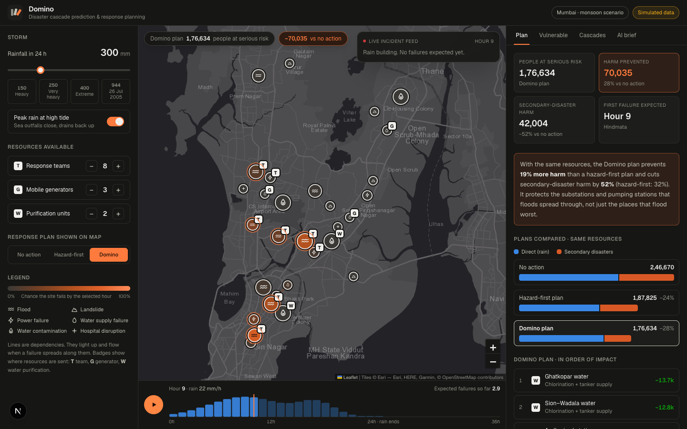

# Domino: disaster cascade prediction and response planning

**ORCATHON 2026 · Track 04: Environment & Sustainability**

One storm doesn't cause one disaster. Extreme rain floods a ward, the flood reaches a substation, the substation stops a
pumping station, and a day later half a million people have contaminated tap water. Domino models that chain,
shows how a storm unfolds hour by hour on a real city map, and plans where to send a limited set of rescue teams and
emergency supplies so the chain breaks early.



**Live demo:** https://domino-orcathon.vercel.app · **Code:** https://github.com/Mayur280star/domino-orcathon · **Video:** _add the video link here_

## What it does

| The problem statement asks for… | Domino |
|---|---|
| Simulate how extreme rainfall causes floods, landslides, power failures and water contamination | A 24-hour storm (80 to 950 mm, optional high tide) runs across 30 real Mumbai sites: 9 flood-prone wards, 5 hillside settlements, 4 substations, 4 water plants and pumping stations, 4 water-supply zones and 4 hospitals |
| Predict how these events affect one another | 30 dependency links (floodwater → substation, power loss → pumps, broken supply → contamination, debris → pipelines, outages → hospitals). The app ranks the most damaging cascade chains and shows how often each one happens |
| Identify vulnerable locations | Each site is ranked by the harm it does itself **plus** the harm it triggers downstream. A substation that floods nobody's home can still be the most dangerous place in the city |
| Allocate limited rescue teams and emergency supplies to reduce overall risk | A cascade-aware optimiser places response teams, mobile generators and water purification units, then compares the result against "no action" and a standard hazard-first plan given the same resources |
| (Bonus) Make it usable during an emergency | Hour-by-hour storm playback with a live incident feed, a details card for every site, and a commander's briefing written by AI from the simulation output |

## How it works

### 1. Cascade model (`src/lib/sim/engine.ts`)

- The city is a directed graph. Flood and landslide sites fail when cumulative rain crosses their threshold. Each storm
  draws its thresholds from a log-normal distribution (σ = 0.22) because drains, soil and blockages are never exactly known.
- Every dependency edge has a probability and a delay in hours. A failure spreads along an edge if that edge "fires" in
  that storm. The earliest failure time for every site comes from a shortest-path pass (Bellman-Ford) over the fired edges.
  That gives the hour each site fails and the edge that caused it.
- **Monte Carlo:** 1,000 storms per scenario. Per site, Domino tracks the chance it fails, the hour it usually fails,
  the share of failures caused by rain versus by a cascade, its expected harm, and the harm it causes downstream (each
  failure's harm is credited to every ancestor in its causal chain).
- Harm is measured in **people at serious risk**: people exposed × the share seriously affected by that kind of failure.

### 2. Cascade-aware optimiser

- Greedy marginal-gain search: place one resource at a time wherever it cuts the most expected harm. Every candidate is
  scored by **re-running the whole cascade simulation**, so protecting a substation is credited for the pumps,
  water and hospitals downstream of it.
- Resources have realistic limits. A response team can help about 4,000 people, so in a ward of 3 lakh it makes a dent
  rather than halving the damage. Teams can evacuate, dewater, or sandbag a substation or pump house. Generators keep
  pumps or hospitals running without grid power. Purification units chlorinate a supply zone and run tankers.
- **Common random numbers:** every plan is scored on the same simulated storms, so differences come from the plan,
  not from luck. The plan is chosen on 300 storms and scored on a separate set of 1,000.
- Runs in the browser in about 60 ms (around 400 full-cascade simulations), so every slider move re-plans live.

### 3. AI commander's briefing (`src/app/api/brief/route.ts`)

The simulation's key facts (cascades, vulnerable sites, the plan, the hour-by-hour watch list) go to a large
language model, which writes a briefing a commander can read in 30 seconds. The live demo uses **NVIDIA Nemotron 3.5
Super** through OpenRouter's free tier (reasoning off, so it answers in about 10 seconds), falling back to other free models if it's busy. Setting `ANTHROPIC_API_KEY` switches it to
**Claude (claude-opus-5-5)**. The model may only use numbers that
come from the simulation. If no key is configured, or the call fails, a rule-based briefing is used instead, so the demo
never breaks.

## Results

Same resources in every plan: 8 response teams, 3 mobile generators, 2 purification units. Run it yourself with `npm run check`.

| Rain (24 h) | High tide | No action | Hazard-first | Domino | Secondary-disaster harm (none → hazard-first → Domino) |
|---|---|---|---|---|---|
| 150 mm | no | 49,661 | 36,725 (−26%) | **25,975 (−48%)** | 23,925 → 17,033 → **5,311** |
| 250 mm | no | 1,94,586 | 1,44,139 (−26%) | **1,29,378 (−34%)** | 74,462 → 49,910 → **27,882** |
| 300 mm | yes | 2,46,670 | 1,87,825 (−24%) | **1,76,634 (−28%)** | 88,119 → 60,207 → **42,004** |
| 400 mm | no | 2,63,707 | 2,02,918 (−23%) | **1,90,700 (−28%)** | 96,868 → 67,707 → **39,853** |

In every scenario Domino prevents more harm than the hazard-first plan. The biggest gain is in secondary disasters:
Domino cuts them by 52–78% in these scenarios, while hazard-first manages 29–33%. It wins by sending teams to sandbag the
Kurla and Andheri substations and the Bhandup treatment plant, and generators to pumping stations, instead of putting
everything where the flooding is deepest.

## Data and limitations

Locations are real Mumbai places (flood spots like Hindmata, Milan Subway and Andheri Subway; hillside settlements in
Chembur, Vikhroli and Bhandup; the Bhandup water complex; KEM, Sion, Rajawadi and Cooper hospitals). **Populations,
thresholds and dependency probabilities are illustrative values set for this prototype, not official risk data.** In
a real deployment they would come from municipal drainage data, IMD rainfall forecasts, utility network maps and
historical incident logs. The model and optimiser would not need to change.

## Tech stack

- **Next.js 16** (App Router) + **React 19** + **TypeScript** + **Tailwind CSS 4**
- **Leaflet** with Esri Dark Gray Canvas tiles (© Esri, HERE, Garmin, OpenStreetMap contributors)
- **OpenRouter** (NVIDIA Nemotron 3.5 Super, free tier) for the briefing, with the **Claude API** (`@anthropic-ai/sdk`, `claude-opus-5-5`) as the alternative provider
- Simulation and optimiser: plain TypeScript, no ML libraries, running client-side
- Deployed on **Vercel**

## Run locally

```bash
npm install
npm run dev          # http://localhost:3000
npm run check        # print the results table above
```

Optional, for the AI briefing, add one of these to `.env.local`:

```
OPENROUTER_API_KEY=...       # OpenRouter (free models work)
OPENROUTER_MODEL=...         # optional, default nvidia/nemotron-3.5-super-vl:free
ANTHROPIC_API_KEY=...        # or Claude, used first when set
```

## Hackathon disclosure

- **Built during ORCATHON on 25 October 2026.** No code from earlier projects. The only starting point was the
  standard `create-next-app` template.
- **AI tools used:** Claude Code (Anthropic's AI coding assistant) helped write the code. The app calls an LLM
  (NVIDIA Nemotron 3.5 Super via OpenRouter, or Claude) to write the commander's briefing.
- **Open-source libraries:** Next.js, React, Leaflet, Tailwind CSS, the Anthropic SDK, all under their own licences.
